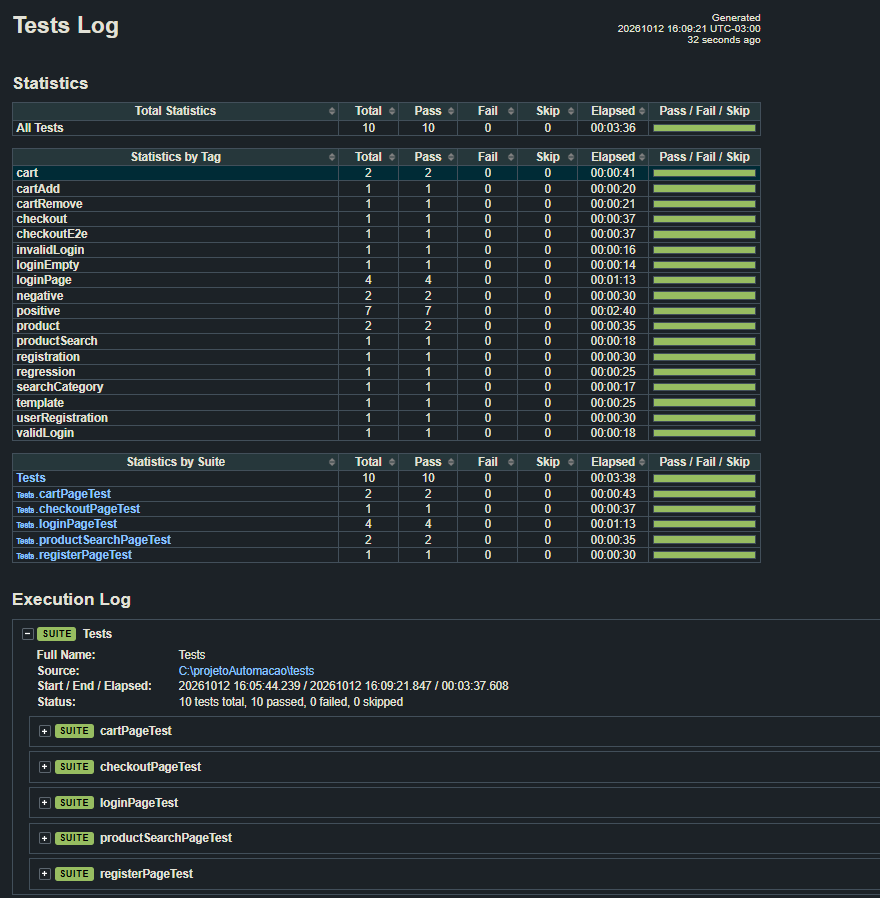

# Projeto de Automação Web com Robot Framework

Projeto desenvolvido para automação de testes funcionais da aplicação Automation Exercise utilizando Robot Framework e Selenium.

# Funcionalidades Automatizadas 

 * W01-User registration
 * W02-Login — valid credentials
 * W03-Login — invalid credentials
 * W04-Product search
 * W05-Add product to cart
 * W06-E2E checkout flow
 * W07-Remove product from cart
 * W08-Mandatory email validation
 * W09-Category navigation
 * W10-Template/Outline/Examples

# Tecnologias Utilizadas

- Robot Framework
- SeleniumLibrary
- FakerLibrary
- Python
- ChromeDriver
- VS Code 

# Estrutura do Projeto
```text
projetoAutomacao/
├── .vscode/
│   └── launch.json
│
├── config/
│   ├── exporters/
│   │   ├── helpers.robot
│   │   ├── libraries.robot
│   │   ├── pageObjects.robot
│   │   └── stepsKeywords.robot
│   │
│   ├── setup/
│   │   └── driver.robot
│   │
│   └── Keywords_steps/
│       └── hooks/
│           ├── commonHooks.robot
│           ├── cartPageSteps.robot
│           ├── checkoutPageSteps.robot
│           ├── loginPageSteps.robot
│           ├── productSearchPageSteps.robot
│           └── registerPageSteps.robot
│
├── log/
│
├── pageElements/
│   ├── cartPage.robot
│   ├── checkoutPage.robot
│   ├── loginPage.robot
│   ├── productSearchPage.robot
│   └── registerPage.robot
│
├── resources/
│   └── data/
│       ├── loginData.Robot
│       └── productData.Robot
│
├── results/
│
├── tests/
│   ├── log/
│   ├── cartPageTest.robot
│   ├── checkoutPageTest.robot
│   ├── loginPageTest.robot
│   ├── productSearchPageTest.robot
│   └── registerPageTest.robot
│
├── .gitignore
├── README.md
├── relatorioImage.png
└── requirements.txt
```

# Instalação
Clone o projeto:

git clone https://github.com/ncsilveira/robotframework-automationexercise

Acesse a pasta:
cd projetoAutomacao
Instale as dependências:

pip install -r requirements.txt

# Como Executar:  

Executar toda a suíte: 
* robot -d Results Tests/

Executar por tag:
* robot -d results -i loginPage tests/
* robot -d results -i cart tests/ 
* robot -d results -i checkout tests/ 
* robot -d results -i product tests/ 
* robot -d results -i registration tests/ 

# Relatórios

Após a execução são gerados automaticamente:

- report.html
- log.html
- output.xml

Localizados na pasta:
results/ 



